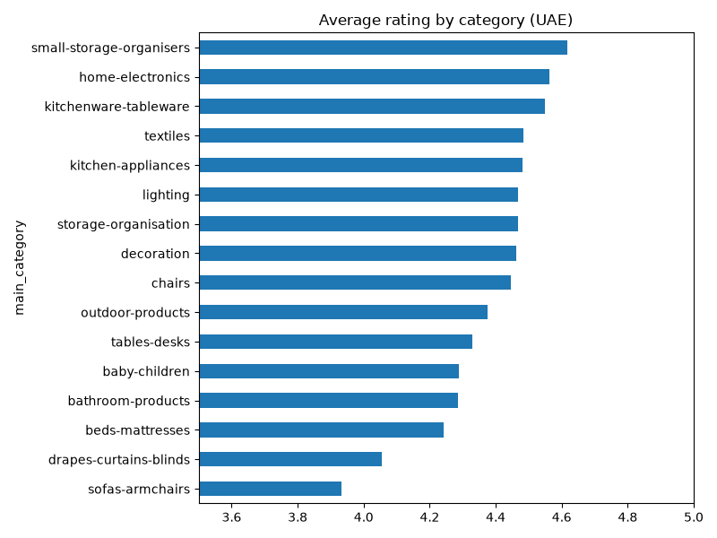
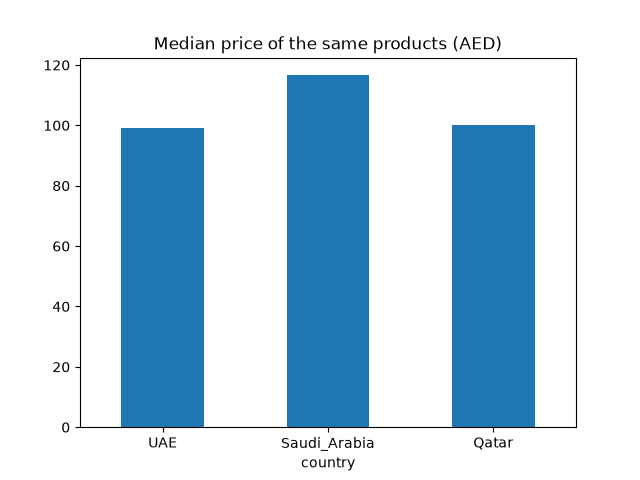
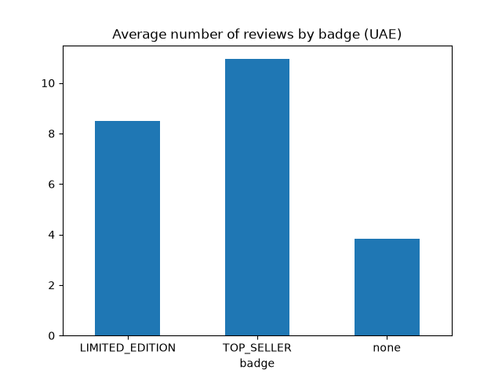

<div align="center">

# 🛋️ IKEA UAE: Product Performance & Customer Feedback Analysis

**How are IKEA products doing in the UAE, and what can be improved?**


</div>

---

## 📌 Key results at a glance

| | Finding | Number |
|:-:|---|:-:|
| 🛋️ | Lowest rated category in the UAE | **Sofas: 3.93 ⭐** |
| 📦 | Highest rated category in the UAE | **Small storage: 4.62 ⭐** |
| 💰 | UAE prices compared with Saudi Arabia | **~15% cheaper** |
| 🏷️ | Top Sellers compared with other products | **Same rating, ~3x more reviews** |
| 🆕 | New products in the UAE | **715** |

---

## 📑 Contents

1. [The business question](#-the-business-question)
2. [The data](#-the-data)
3. [The process](#️-the-process)
4. [Questions and answers](#-questions-and-answers)
5. [Recommendations](#-recommendations)
6. [Limitations](#️-limitations)
7. [How to run](#️-how-to-run)

---

## 🎯 The business question

Imagine I am a data analyst at **IKEA UAE**, and my manager asks:

> *"How are our products doing in the UAE, and what can we improve?"*

This question is too big to answer at once, so I split it into **4 smaller questions**:

| # | Question | Why it matters |
|:-:|---|---|
| 1 | Which categories do customers rate best and worst? | Shows where customers are unhappy |
| 2 | Are UAE prices higher or lower than in Saudi Arabia and Qatar? | Shows our price position in the Gulf |
| 3 | Do "Top Seller" products get better ratings? | Tells us what the badge really means |
| 4 | How many products are new or have a new lower price? | Shows how fresh the product range is |

---

## 📂 The data

| | |
|---|---|
| **Source** | [IKEA Global Product Catalog and Price 2026 (Kaggle)](https://www.kaggle.com/datasets/ranjithpanicker/ikea-global-product-catalog-and-price-2026/data) |
| **Size** | 401,046 rows × 18 columns |
| **Countries** | 46 (the UAE has 9,242 products) |
| **Currencies** | 34 (each country uses its local currency) |

**Main columns used:**

| Column | Meaning |
|---|---|
| `country` | Country where the product is sold |
| `main_category` | Product category (sofas, lighting, ...) |
| `product_rating` | Average customer rating (1 to 5) |
| `product_rating_count` | Number of customer reviews |
| `price` / `currency` | Price in local currency |
| `badge` | TOP_SELLER, LIMITED_EDITION or none |
| `sale_tag` | NEW_PRODUCT, NEW_LOWER_PRICE, ... |

> ℹ️ The CSV file is not in this repo because it is bigger than GitHub's 100 MB limit. Download it from the Kaggle link above.

---

## ⚙️ The process

```
 1. Explore  ──►  2. Clean  ──►  3. Filter  ──►  4. Analyze  ──►  5. Visualize
```

### 1️⃣ Explore the data (EDA)

Before any analysis, I looked at the data to understand it: the number of rows and columns, the column names, the data types, and the values in each column.

<details>
<summary>📝 Code</summary>

```python
df = pd.read_csv("IKEA_product_catalog.csv")
df.shape
df.info()
df["country"].value_counts()
df["price"].describe()
```
</details>

**What I found:** there were no empty cells, but the rating columns were stored as **text**, not numbers. That was the first problem to fix.

### 2️⃣ Clean the data

Products with no rating had the word `"none"` instead of a number. Because of this word, pandas treated the whole column as text, so I couldn't calculate an average.

I replaced `"none"` with `NaN` (an empty value) and changed the column to numbers.

<details>
<summary>📝 Code</summary>

```python
df["product_rating"] = pd.to_numeric(df["product_rating"].replace("none", np.nan))
df["product_rating_count"] = pd.to_numeric(df["product_rating_count"].replace("none", np.nan))
```
</details>

**Why NaN and not 0?** A 0 would count as a real rating of zero and pull the average down. With NaN, pandas skips the empty values.

| Example ratings | Using 0 | Using NaN |
|---|:-:|:-:|
| 5, 4, none | (5+4+0)/3 = **3.0** ❌ | (5+4)/2 = **4.5** ✅ |

**Result:** 131,960 products have no rating. They are now correctly marked as empty.

### 3️⃣ Filter to the UAE

The data covers 46 countries, but the question is about the UAE, so I kept only UAE products.

<details>
<summary>📝 Code</summary>

```python
uae = df[df["country"] == "UAE"]   # 9,242 products
```
</details>

### 4️⃣ Analyze

I used `groupby` and `agg` to summarize the products by category and by badge, and `pivot_table` to compare prices between countries. The details are in the next section.

### 5️⃣ Visualize

I made one simple bar chart for each finding with matplotlib and saved them in the `images` folder.

---

## 💡 Questions and answers

### Q1. Which categories do customers rate best and worst?

I grouped UAE products by category and calculated the number of products, the average rating and the total number of reviews. I removed categories with fewer than 50 products so that a few products can't make the average misleading.

<details>
<summary>📝 Code</summary>

```python
cat = uae.groupby("main_category").agg(
    products=("product_id", "count"),
    avg_rating=("product_rating", "mean"),
    total_reviews=("product_rating_count", "sum"))

cat = cat[cat["products"] >= 50]
cat = cat.sort_values("avg_rating", ascending=False)
```
</details>



| 🏆 Top 3 | Rating | | ⚠️ Bottom 3 | Rating |
|---|:-:|---|---|:-:|
| Small storage organisers | 4.62 | | Beds & mattresses | 4.24 |
| Home electronics | 4.56 | | Curtains & blinds | 4.06 |
| Kitchenware & tableware | 4.55 | | **Sofas & armchairs** | **3.93** |

> ✅ **Answer:** Customers are happiest with small storage items. **Sofas have the lowest rating (3.93)**, so this is the category that needs attention.

---

### Q2. Are UAE prices higher or lower than in Saudi Arabia and Qatar?

**Step 1: One currency.** Each country uses its own currency, so I converted all prices to AED. The Saudi riyal and Qatari riyal are pegged to the US dollar like the dirham, so the rates are stable.

| Currency | 1 unit in AED |
|---|:-:|
| AED | 1.00 |
| SAR | 0.98 |
| QAR | 1.01 |

**Step 2: Same products only.** I used `pivot_table` to put each product in one row and each country in a column. Then `dropna()` removed products that are not sold in all 3 countries, so the comparison is fair.

| | Products |
|---|:-:|
| Before `dropna` | 12,309 |
| After `dropna` (sold in all 3 countries) | **5,136** |

<details>
<summary>📝 Code</summary>

```python
gulf = df[df["country"].isin(["UAE", "Saudi_Arabia", "Qatar"])].copy()

rates = {"AED": 1.0, "SAR": 0.98, "QAR": 1.01}
gulf["price_aed"] = gulf["price"] * gulf["currency"].map(rates)

t = gulf.pivot_table(index="product_id", columns="country", values="price_aed")
t = t.dropna()

t["uae_vs_saudi_%"] = (t["UAE"] / t["Saudi_Arabia"] - 1) * 100
t["uae_vs_qatar_%"] = (t["UAE"] / t["Qatar"] - 1) * 100
```
</details>



| Compared with | Median difference | UAE is cheaper for |
|---|:-:|:-:|
| 🇸🇦 Saudi Arabia | **-15%** | 70% of products |
| 🇶🇦 Qatar | -1% | 79% of products |

*(A negative number means the UAE is cheaper.)*

> ✅ **Answer:** The UAE is **about 15% cheaper than Saudi Arabia** for the same products. Prices in the UAE and Qatar are almost the same.

---

### Q3. Do "Top Seller" products get better ratings?

I grouped UAE products by their badge and compared the average rating and the average number of reviews.

<details>
<summary>📝 Code</summary>

```python
badge = uae.groupby("badge").agg(
    products=("product_id", "count"),
    avg_rating=("product_rating", "mean"),
    avg_reviews=("product_rating_count", "mean"))
```
</details>



| Badge | Products | Avg rating | Avg reviews |
|---|:-:|:-:|:-:|
| 🏷️ TOP_SELLER | 665 | 4.41 | **10.95** |
| ✨ LIMITED_EDITION | 159 | 4.48 | 8.50 |
| No badge | 8,418 | 4.41 | 3.84 |

**Top Seller products with the most reviews in the UAE:**

| Product | Type | Rating | Reviews |
|---|---|:-:|:-:|
| FNISS | Waste bin | 4.8 | 94 |
| KLEPPSTAD | Wardrobe with 3 doors | 4.4 | 89 |
| KULLEN | Chest of 2 drawers | 4.2 | 83 |

> ✅ **Answer:** Top Sellers are **not rated higher** (4.41, the same as other products), but they get **about 3x more reviews**. More reviews suggest more people buy them. So the badge means *popular*, not *better quality*.

---

### Q4. How many products are new or have a new lower price?

<details>
<summary>📝 Code</summary>

```python
uae["sale_tag"].value_counts()
```
</details>

| Sale tag | Products |
|---|:-:|
| 🆕 New product | 715 |
| 🔻 New lower price | 1,185 |
| No tag | 7,342 |
| Discontinued | 0 |

> ✅ **Answer:** About **20% of UAE products** are new or have a new lower price, and no products are discontinued.

---

## 🚀 Recommendations

1. **Check sofa reviews.** Sofas have the lowest rating. Reading the reviews could show the main problem (comfort, quality or delivery).
2. **Use the price advantage.** The UAE is about 15% cheaper than Saudi Arabia, which can be used in marketing.
3. **Don't read "Top Seller" as "best quality".** The badge shows popularity, not higher customer satisfaction.

---

## ⚠️ Limitations

- The data has **no sales numbers**, so the number of reviews is only a sign of popularity.
- The data is a **snapshot** from one point in time, so I can't see trends over time.
- Many products have **no rating** (131,960 rows in the full data).

---

## ▶️ How to run

1. Download the CSV from [Kaggle](https://www.kaggle.com/datasets/ranjithpanicker/ikea-global-product-catalog-and-price-2026/data) and put it in this folder.
2. Install the libraries:
   ```
   pip install pandas numpy matplotlib jupyter
   ```
3. Open `ikea_analysis.ipynb` and run all cells.

```
ikea-project/
├── ikea_analysis.ipynb
├── README.md
├── .gitignore
└── images/
    ├── ratings_by_category.png
    ├── gulf_prices.png
    └── reviews_by_badge.png
```

---

<div align="center">

**Moustafa Gamal** · Data Analyst

</div>
